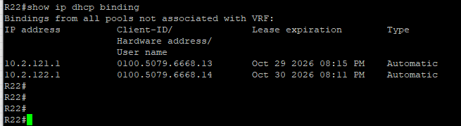
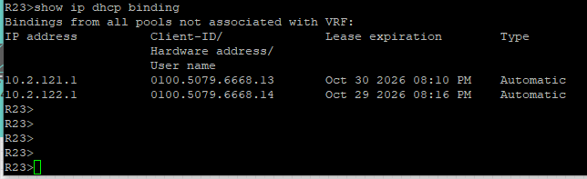

### DHCP (Dynamic Host Configuration Protocol)

DHCP сервис на маршрутизаторах в офисах Н.Новгород (R13-R14) и Бор (R22-R23) поднят с использованием протокола HSRP (Hot Standby Router Protocol), который позволяет объединить два или более маршрутизатора в виртуальную группу для обеспечения отказоустойчивости шлюза по умолчанию. По два DHCP-сервера раздают все доступные IP-адреса из настроенных пулов, кроме назначенных статически.

####  Пример настройки DHCP, HSRP на R22
```
! Исключаем служебные адреса и диапазон второго роутера из DHCP
ip dhcp excluded-address 10.2.121.250 10.2.121.254
ip dhcp excluded-address 10.2.122.250 10.2.122.254
! Создаем пул для первой подсети
ip dhcp pool 1
 network 10.2.121.0 255.255.255.0
! В качестве шлюза указываем виртуальный IP HSRP
 default-router 10.2.121.254
 dns-server 8.8.8.8
! Создаем пул для пвторой подсети
ip dhcp pool 2
 network 10.2.122.0 255.255.255.0
 default-router 10.2.122.254
 dns-server 8.8.8.8
!
! Настройка интерфейсов и HSRP
interface Ethernet0/0
 ip address 10.2.121.252 255.255.255.0
 standby 1 ip 10.2.121.254
! Настраиваем приоритет данного маршрутизатора в этой группе на уровне 110 (по умолчанию = 100)
 standby 1 priority 110
! Позволим маршрутизатору с более высоким приоритетом автоматически перехватывать роль активного если он возвращается в сеть
 standby 1 preempt
!
interface Ethernet0/3
 ip address 10.2.122.252 255.255.255.0
 standby 2 ip 10.2.122.254
 standby 2 preempt
```

####  Пример настройки DHCP, HSRP на R23
```
!
ip dhcp excluded-address 10.2.122.250 10.2.122.254
ip dhcp excluded-address 10.2.121.250 10.2.121.254
ip dhcp pool 2
 network 10.2.122.0 255.255.255.0
 default-router 10.2.122.254
 dns-server 8.8.8.8
ip dhcp pool 1
 network 10.2.121.0 255.255.255.0
 default-router 10.2.121.254
 dns-server 8.8.8.8
!
interface Ethernet0/0
 ip address 10.2.122.253 255.255.255.0
 standby 2 ip 10.2.122.254
 standby 2 priority 110
 standby 2 preempt
!
interface Ethernet0/3
 ip address 10.2.121.253 255.255.255.0
 standby 1 ip 10.2.121.254
 standby 1 preempt
```

#### Файлы с настройками устройств
[DHCP server на R22](../configs/R22#L125-L149) ;
[DHCP server на R23](../configs/R23#L262-L298)

#### Команды для проверки работы DHCP
```
show ip dhcp binding - Выводит список всех выданных IP-адресов
show ip dhcp pool - Показывает статус настроенных пулов адресов
show ip dhcp server statistics - Отображает статистику отправленных и полученных DHCP-пакетов
show ip dhcp conflict - Выводит список обнаруженных конфликтов IP-адресов
show dhcp lease - Проверка аренды на клиенте-интерфейсе
```

#### Результат работы DHCP


---

