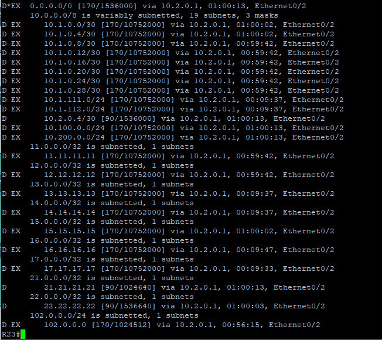
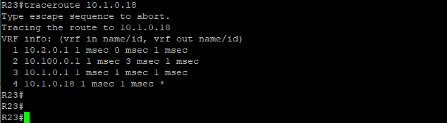

### EIGRP (Enhanced Interior Gateway Routing Protocol)

Для настройки используем EIGRP Named Mode (Именованный режим) — это современный подход Cisco, который объединяет все настройки EIGRP (IPv4, параметры интерфейсов и адресацию) в одном общем блоке конфигурации. Нет необходимости переходить между глобальным режимом и настройкой конкретных интерфейсов — всё администрируется централизованно.<br>
В офисе Бор настроен EIGRP. Передача маршрутов между OSPF (Н.Новгород) и EIGRP (Бор) выполняется с помощью процедуры редистрибуции на пограничном маршрутизаторе, который запущен в обеих зонах.

####  Пример настройки на R21
```
! Указываем произвольное текстовое имя виртуального процесса
router eigrp BOR-EIGRP
! Активируем IPv4 и задаем ASN (должен совпадать у всех EIGRP-соседей)
 address-family ipv4 unicast autonomous-system 100
! EIGRP включается на интерфейсах которые попадают в указанные подсети (на линке между EIGRP-соседями)
  network 10.2.0.0 0.0.0.3
  network 10.2.0.4 0.0.0.3
! В Named Mode настройки конкретного интерфейса задаются прямо внутри конфигурации EIGRP в разделе:
! Для одновременного применения настроек ко всем интерфейсам используется
  af-interface default
   passive-interface
  exit-af-interface
! Режим настройки параметров EIGRP для конкретноых интерфейсов:
  af-interface Ethernet0/3
   no shutdown
   no passive-interface
  exit-af-interface
  af-interface Tunnel0
    no shutdown
    no passive-interface
  exit-af-interface
! Режим настройки параметров базовой топологии для конкретного Address Family
  topology base
   no auto-summary
! Редистрибуция (импорт) маршрутов из протокола OSPF в протокол EIGRP
   redistribute ospf 1 metric 1000 1000 255 127 1500
  exit-af-topology
 exit-address-family
!
```

####  Пример настройки на R23
```
router eigrp BOR-EIGRP
 !
 address-family ipv4 unicast autonomous-system 100
  !
  af-interface default
   passive-interface
  exit-af-interface
  !
  af-interface Ethernet0/2
   no passive-interface
  exit-af-interface
  !
  topology base
  exit-af-topology
  network 10.2.0.0 0.0.0.3
  network 10.2.121.0 0.0.0.255
  network 10.2.122.0 0.0.0.255
  network 23.23.23.23 0.0.0.0
 exit-address-family
```

#### Файлы с настройками устройств
[EIGRP на R21](../configs/R21#L68-L100) ;
[EIGRP на R23](../configs/R23#L19-L38)

#### Команды для проверки работы EIGRP
```
show ip eigrp interfaces ! Показывает на каких интерфейсах сейчас активирован протокол
show ip eigrp neighbors ! Показывает установленные соглашения с соседними роутерами
show ip eigrp topology ! Показывает содержимое таблицы топологии протокола маршрутизации EIGRP
show ip route eigrp ! Выводит только те маршруты, которые роутер узнал от своих соседей (в таблице они будут с пометкой D)
show ip protocols ! Отображения параметров и текущего состояния всех активных динамических протоколов маршрутизации, настроенных на устройстве
show running-config | section router eigrp
```

#### Результат работы EIGRP


---

