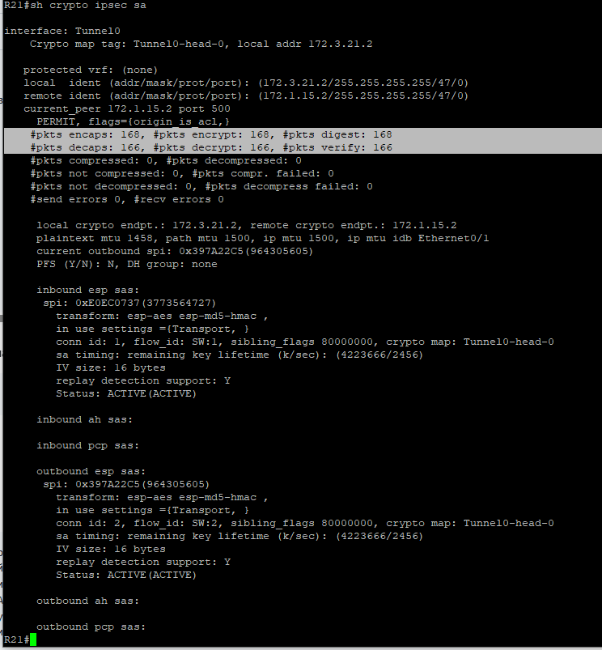

### IPsec (Internet Protocol Security)
Организовано шифрование данных, которые передаются по каналам GRE между R15 (Н.Новгород) и R21 (Бор), а также в DMVPN между R15, R31 (Кантаурово) и R43 (Неклюдово). 
GRE over IPsec, где GRE создает виртуальный туннель (позволяя передавать мультикаст и работать протоколам динамической маршрутизации), а IPsec в транспортном режиме шифрует этот туннель.

####  Пример настройки GRE_over_IPsec на R21
```
! Настройка PHASE 1 (IKE SA туннель). Для фсех IPSec SA одна настройка.
! Создаем IKEv2 Proposal
crypto ikev2 proposal GRE-PROP-PHASE1
 encryption aes-cbc-128   ! Encryption algorithm 
 integrity md5   ! Hash algorithm
 group 2   ! Diffie-Hellman Group
exit
!
! Привязываем Proposal к политике IKEv2 (Policy)
crypto ikev2 policy GRE-IKEV2-POLICY
 proposal GRE-PROP-PHASE1
exit
!
! Общий ключ (Pre-Shared Key) для любого peer
crypto ikev2 keyring KEYRING-1
 peer ANY-SPOKE
  address 0.0.0.0 0.0.0.0  ! IP удаленной стороны - Any host
  pre-shared-key MYSECRET
 exit
exit
!
! Настройка Phase 1.2. Создание и настройка профиля протокола IKEv2 (объединяет в себе все настройки безопасности для VPN-сессии).
! Создание для определенного туннеля или общий профиль
crypto ikev2 profile GRE-IKEV2-PROFILE1
 match identity remote address 0.0.0.0   ! Any host или IP-адрес mask соседа
 authentication remote pre-share   ! Метод проверки - PSK
 authentication local pre-share 
 keyring local KEYRING-1   ! сам один общий PSK
exit
! ----------------------------------
! Настройка PHASE 2. Задаем комбинацию протоколов безопасности, Encryption, Hashing и Mode tunnel, которые будут защищать IPsec-трафик внутри VPN-туннеля
crypto ipsec transform-set GRE-TS esp-aes esp-md5-hmac
 mode transport
exit
!
! Создаем криптографического профиль, который свяжет настройки безопасности IPsec SA с VTI
crypto ipsec profile IPSEC-PROFILE-GRE
 set transform-set GRE-TS
 set ikev2-profile GRE-IKEV2-PROFILE1
exit
!------------------------------------------
!
interface Tunnel0
 description GRE to R15 via ISP1   
 tunnel mode gre ip
 ip address 10.100.0.2 255.255.255.0
 ip mtu 1400 
 ip tcp adjust-mss 1360
 ip ospf cost 10
 tunnel source Ethernet0/1
 tunnel destination 172.1.15.2
 tunnel protection ipsec profile IPSEC-PROFILE-GRE  ! Автоматическое шифрование всего трафика, проходящего через VTI GRE, без использования Traffic Selectors (Crypto ACL)
!
interface Tunnel1
 description GRE to R15 via ISP2
 tunnel mode gre ip
 ip address 10.200.0.2 255.255.255.0
 ip mtu 1400
 ip tcp adjust-mss 1360
 ip ospf cost 100  
 tunnel source Ethernet0/1
 tunnel destination 172.2.15.2
 tunnel protection ipsec profile IPSEC-PROFILE-GRE
!
```

####  Пример настройки GRE_over_IPsec и DMVPN_over_IPsec на R15
```

```

#### Файлы с настройками устройств
[IPsec на R21](../configs/R21#L262-L298) ;
[IPsec на R15](../configs/R15#L125-L149)

#### Команды для проверки IPsec
```
sho crypto ikev2 sa [detailed] - отображение текущего состояния Security Associations протокола IKEv2
sho crypto ikev2 session - состояние сессий или туннелей IKEv2
sh crypto ipsec sa - для диагностики и вывода информации о Security Associations во второй фазе протокола IPsec
!------ через sh crypto ipsec sa смотрим Status=ACTIVE(ACTIVE) и рост значения в #pkts encryp и #pkts decrypt (кол-во зашифрованных и расшифрованных пакетов через туннель)-------
sh crypto ipsec sa detail - для проверки состояния и глубокой диагностики установленных IPsec Security Associations
sh crypto ipsec profile - для отображения настроек профилей IPsec
```

#### Результат работы IPsec


---
