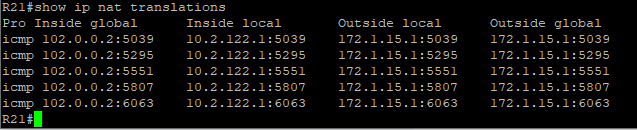
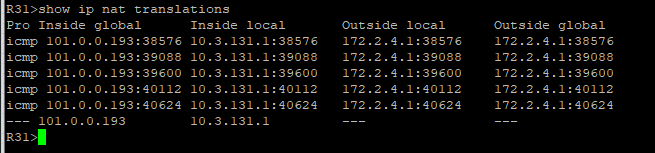

### NAT (Network Address Translation), PAT (Port Address Translation)

NAT(PAT) трансляция на R15, R43 осуществляется в адрес выделенных диапазонов AS64501. NAT трансляция на R31 осуществляться в пул из 5 адресов выделенного диапазона AS64501.<br>
NAT(PAT) трансляция на R21 осуществляется в адрес AS64502.

####  Пример настройки NAT(PAT) на R21
```
! Создаем список доступа для определения внутренней сети
access-list 18 permit 10.2.120.0 0.0.3.255
! Создаем пул из 5 публичных адресов, указывая стартовый и конечный адрес
ip nat pool POOL-NAT 102.0.0.1 102.0.0.254 netmask 255.255.255.0
! Связываем ACL и пул, включая PAT (за счет ключевого слова overload)
ip nat inside source list 18 pool POOL-NAT overload
!
! Маркируем интерфейсы подключенные к локальной сети и к ISP
interface e0/0
 ip nat inside
!
interface e0/1
 ip nat outside
!
interface e0/2
 ip nat inside
```

####  Пример настройки NAT на R31
```
access-list 18 permit 10.3.131.0 0.0.0.255
ip nat pool POOL-NAT 101.0.0.193 101.0.0.197 netmask 255.255.255.192
ip nat inside source list 18 pool POOL-NAT
!
! Маркируем интерфейсы подключенные к локальной сети и к ISP
interface e0/0
 ip nat inside
!
interface e0/1
 ip nat outside
```

#### Файлы с настройками устройств
[NAT на R21](../configs/R21#L125-L149) ;
[NAT на R31](../configs/R31#L262-L298)

#### Команды для проверки работы NAT-трансляций
```
show ip nat translations — просмотр текущей таблицы трансляций портов и адресов
show ip nat statistics — проверка общей статистики работы NAT и наполненности пула
clear ip nat translation * — принудительный сброс динамических трансляций
```

#### Результат работы NAT-трансляций


---

