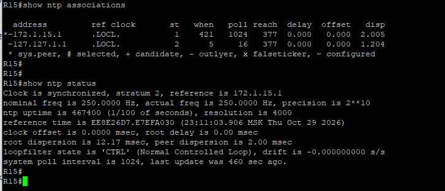
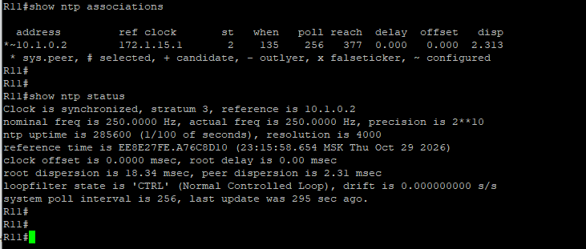

### NTP (Network Time Protocol)

R1 является NTP stratum 1 - к нему подключаются остальные маршрутизаторы ISP и пограничные офисные R15,R21,R31,R43, которые в свою очередь являются NTP-серверами для остальных устройств.

####  Пример настройки NTP на R1
```
! Стандартный ACL: R1 отвечает на NTP-запросы только от конкретных хостов
ip access-list standard 1
  remark "permit to NTP server access"
  10 permit 172.1.15.2 0.0.0.0
  20 permit 172.2.43.2 0.0.0.0
  30 permit 172.3.21.2 0.0.0.0
  40 permit 172.4.31.2 0.0.0.0
  50 permit 172.1.2.2 0.0.0.0
  60 permit 172.1.3.2 0.0.0.0
  70 permit 192.168.14.2 0.0.0.0
  800 deny any
! ACL №1 привязан к процессу NTP, сам R1 не синхронизирует свое время с другими хостами
ntp access-group ipv4 serve-only 1
! Настроен корректный часовой пояс. Роутер работает в качестве NTP-сервера stratum 1. Обновляются аппаратные часы роутера.
clock timezone MSK 3 0
ntp master 1
ntp update-calendar
```
####  Пример настройки NTP на R15
```
 ip access-list standard 1
  remark "permit to NTP server access"
  10 permit 172.1.15.1 0.0.0.0
  200 deny any
! Режим peer разрешает устройству как синхронизироваться с указанными узлами, так и позволять им синхронизироваться в ответ.
ntp access-group ipv4 peer 1
! Включаем R15 в качестве NTP-сервера для хостов центрального офиса Н.Новгород
ip access-list standard 2
  remark "permit to NTP local server"
  10 permit 10.1.0.0 0.0.255.255
  200 deny any
ntp access-group ipv4 serve-only 2
clock timezone MSK 3 0
ntp source Ethernet0/1
ntp master 2
ntp update-calendar
ntp server 172.1.15.1
```

####  Пример настройки NTP на R11
```
ntp source Ethernet0/1
! На устройствах сети используем команду чтобы указать адреса NTP-серверов
ntp server 10.1.0.2
clock timezone MSK 3 0
ntp update-calendar
```

#### Файлы с настройками устройств
[NTP server/client на R15](../configs/R15#L125-L149) ;
[NTP client на R11](../configs/R11#L262-L298)

#### Команды для проверки работы NTP
```
show clock - отображает текущее время программных часов
show clock detail - убедиться, что в качестве источника времени выбран NTP
show ntp status - текущий статус синхронизации и стратум
show ntp associations - детальную информацию о соединениях с NTP-серверами
```

####  Результат работы NTP:


---

