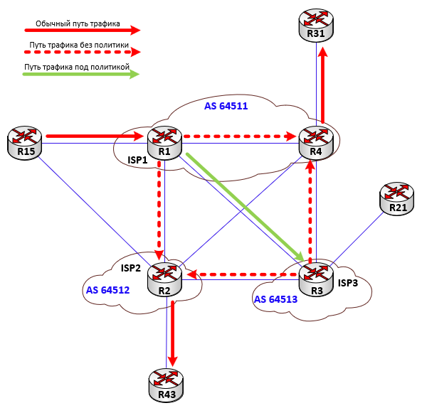
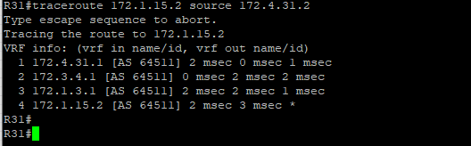

### PBR (Policy-based routing)
Policy-based routing (PBR) - маршрутизация на основе определенных политик (правил, условий), которые устанавливаются администратором. Для реализации PBR на оборудовании сети провайдера трафик из R15 (Н.Новгород) до R43 (Неклюдово) и R31 (Кантаурово), также трафик из R31 до R15 направляется через ISP3 (R3).
| Router | Policy                        | Next-hop |
|--------|-------------------------------|----------|
| R1     | Traffic R15 -> R31 through R3 | 10.1.3.2 |
| R1     | Traffic R15 -> R43 through R3 | 10.1.3.2 |
| R4     | Traffic R31 -> R15 through R3 | 10.3.4.1 |

Для этого: 1. Созданы списки доступа ACL; 2. Созданы route-map, c критериями отбора трафика через match (привязка ACL к соответствующему route-map), и адресом next-hop; 3. Применена заданная политика на входящем интерфейсе.

####  Пример настройки на R1
```
! Создаем ACL, который точно описывает нужный трафик (R15->R31, R15->R43)
ip access-list extended PBR-TRAFFIC
 remark "PBR FROM R15 TO R31 AND R43 THROUGH R3"
 10 permit ip host 172.1.15.2 host 172.4.31.2
 20 permit ip host 172.1.15.2 host 172.2.43.2
 100 deny ip any any
!
! Создаем RM, который проверяет созданный ACL и задает следующий роутер (next-hop)
route-map TO-SPECIFIC-ROUTER permit 10
 match ip address PBR-TRAFFIC
 set ip next-hop 172.1.3.2
!
! На интерфейсе откуда трафик заходит в роутер применяем политику
interface e0/0
 ip policy route-map TO-SPECIFIC-ROUTER
```

####  Пример настройки на R4
```
!
ip access-list extended PBR-TRAFFIC
 remark "PBR FROM R31 TO R15 THROUGH R3"
 10 permit ip host 172.4.31.2 host 172.1.15.2
 100 deny ip any any
!
route-map TO-SPECIFIC-ROUTER permit 10
 match ip address PBR-TRAFFIC
 set ip next-hop 172.3.4.1
!
interface e0/1
 ip policy route-map TO-SPECIFIC-ROUTER
```

#### Файлы с настройками устройств
[NAT server на PC-R1](../configs/R1#L125-L149) ;
[DHCP server/client на ZL-R1](../configs/R1#L262-L298)

#### Команды для проверки настроек PBR
```
show access-lists - вывод содержимого всех настроенных списков контроля доступа
show route-map - вывод конфигурации и статистики карт маршрутизации
show ip policy - отображение настроенных политик маршрутизации и их привязки к интерфейсам
show ip route static - отображения только статически настроенных маршрутов в таблице маршрутизации IPv4
```

#### Результат работы PBR 


---

