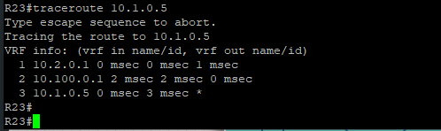
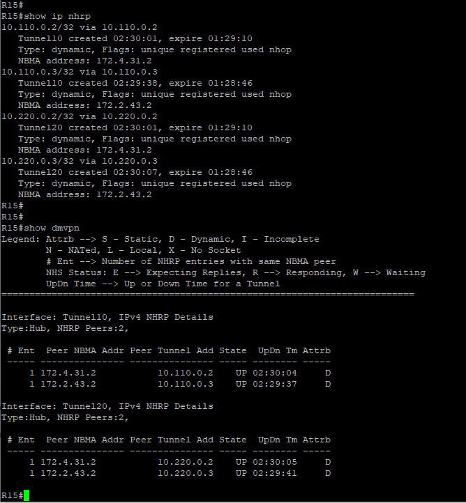

### VPN туннели

### GRE
Настройка двух GRE-туннелей между R15 (Н.Новгород) с двумя провайдерами и R21 (Бор) выполняется через создание двух независимых туннелей и разное назначение стоимости интерфейсов в OSPF для управления приоритетом каналов. Также будет организовано шифрование данных, передаваемых в туннелях (GRE over IPSec).

| Network IPv4  | Description                                                                      |
|---------------|----------------------------------------------------------------------------------|
| 10.100.0.0/24 | Для GRE-туннеля между Бор (R21) и Н.Новгород (R15) через основного ISP1          |
| 10.200.0.0/24 | Для GRE-туннеля между Бор (R21) и Н.Новгород (R15) через второго резервного ISP2 |

####  Пример настройки GRE на R21
```
! Основной канал до R15 через ISP1
interface Tunnel0
 description GRE to R15 via ISP1   
! Режим инкапсуляции GRE поверх протокола IP
 tunnel mode gre ip
 ip address 10.100.0.2 255.255.255.0
! Уменьшаем MTU и MSS для избежания фрагментации пакетов
 ip mtu 1400   ! Размер L3 на интерфейсе туннеля (Ethernet MTU - 1500 байт)
 ip tcp adjust-mss 1360   ! L4 - значение MSS еще на 40 байт меньше
 ip ospf cost 10   ! Стоимость основного туннеля
! Указываем внешние интерфейс и адрес маршрутизаторов:
 tunnel source Ethernet0/1
 tunnel destination 172.1.15.2
!
! Резервный GRE до R15 через ISP2
interface Tunnel1
 description GRE to R15 via ISP2
tunnel mode gre ip
 ip address 10.200.0.2 255.255.255.0
 ip mtu 1400
 ip tcp adjust-mss 1360
 ip ospf cost 100    ! Увеличиваем стоимость резервного туннеля
 tunnel source Ethernet0/1
 tunnel destination 172.2.15.2
!
```

#### Файлы с настройками устройств
[GRE на R21](../configs/R21#L125-L149) ; [GRE на R15](../configs/R15#L125-L149) <br>

#### Результат поднятия GRE-туннелей между Н.Новгород и Бор
 <br>
---
### DMVPN (Dynamic Multipoint Virtual Private Network)
DMVPN строится на базе протоколов mGRE (Multipoint GRE) и NHRP (Next Hop Resolution Protocol). Между R15, R31 и R43 поднят DMVPN в 3-ей фазе, где R15 - hub, а R31 и R43 - spoke.
-------как настроить mGRE с одним hub и двумя spoke если у hub два входа в интернет (основной и резервный)-------------

Созданы два отдельных mGRE туннеля (по одному под каждого провайдера) и запущен OSPF поверх обоих для обеспечения отказоустойчивости и балансировки.
Вариант дизайна Single Hub, Dual Cloud: На Hub два туннельных интерфейса. Каждый туннель привязан к конкретному внешнему интерфейсу (tunnel source). На каждом Spoke настраиваются два туннельных интерфейса, которые смотрят на разные внешние IP-адреса Hub. <br>
Для управления приоритетом каналов назначена разная стоимость интерфейсов в OSPF. <br>
Также будет организовано шифрование данных, передаваемых в туннелях (DMVPN over IPSec).

| Network IPv4  | Description                                                            |
|---------------|------------------------------------------------------------------------|
| 10.110.0.0/24 | Для mGRE туннелей через основного ISP1 (Hub <> Spoke1, Spoke2)          |
| 10.220.0.0/24 | Для mGRE туннелей через второго резервного ISP2 (Hub <> Spoke1, Spoke2) |

####  Пример настройки DMVPN на R15
```
! Настройка первого mGRE туннеля через основного ISP1
interface Tunnel10
 ip address 10.110.0.1 255.255.255.0
 no ip redirects
 ip mtu 1400
 ip tcp adjust-mss 1360
 ip nhrp map multicast dynamic   ! Добавили NHRP к туннелю (для динамического добавления spoke в список рассылки multicast по протоколу NHRP)
 ip nhrp network-id 100   ! id должен совпадать с обеих сторон
! Позволяем Hub сообщать Spokes о наличии более оптимального пути spoke-to-spoke для разгрузки центрального узла
 ip nhrp redirect   ! для реализации Phase3
! Принудительно установим тип сети OSPF в DMVPN в значение Broadcast (широковещательная многоточечная сеть)
 ip ospf network broadcast   ! тип сети OSPF
 ip ospf priority 255   ! при broadcast типе Hub гарантированно становится DR
 ip ospf cost 10   ! Стоимость основного туннеля
 tunnel source Ethernet0/1   ! Указываем внешний интерфейс для туннеля
 tunnel mode gre multipoint   ! Настраиваем многоточечный туннель mGRE
 ip ipsec profile MP-PROFILE  ! для IPsec
 tunnel key 10
! 
! Настройка второго mGRE туннеля через резервного ISP2
interface Tunnel20
 ip address 10.220.0.1 255.255.255.0
 no ip redirects
 ip mtu 1400
 ip tcp adjust-mss 1360
 ip nhrp map multicast dynamic
 ip nhrp network-id 100
 ip nhrp redirect
 ip ospf network broadcast   ! тип сети OSPF на туннельных интерфейсах
 ip ospf priority 255  ! Hub гарантированно становится DR
 ip ospf cost 100  ! Увеличиваем стоимость резервного туннеля
 tunnel source Ethernet0/3
 tunnel mode gre multipoint
 ip ipsec profile MP-PROFILE
 tunnel key 20
!
! Доп.настройка процесса OSPF
router ospf 1
 network 10.110.0.0 0.0.0.255 area 0
 network 10.220.0.0 0.0.0.255 area 0
```

####  Пример настройки DMVPN на R31
```
! Настройка mGRE туннеля к ISP1 (Hub)
interface Tunnel10
 ip address 10.110.0.2 255.255.255.0
 no ip redirects
 ip mtu 1400
 ip tcp adjust-mss 1360
 ip nhrp network-id 100
! Регистрация на Hub (мэппинг внутренний IP туннеля Hub -> Внешний IP Hub)
 ip nhrp nhs 10.110.0.1 nbma 172.1.15.2 multicast
 ip nhrp shortcut   ! для реализации Phase3 технологии DMVPN
 ip ospf cost 10
 ip ospf network broadcast
 ip ospf priority 0    ! Spoke никогда не станет DR/BDR
 tunnel source Ethernet0/1   ! Внешний интерфейс Spoke
 tunnel mode gre multipoint   ! Вместо tunnel destination
 tunnel key 10
!
! Настройка mGRE туннеля к ISP2 (Hub)
interface Tunnel20
 ip address 10.220.0.2 255.255.255.0
 no ip redirects
 ip mtu 1400
 ip tcp adjust-mss 1360
 ip nhrp network-id 100
! Регистрация на резервном IP Hub (мэппинг внутренний IP туннеля Hub -> Внешний IP Hub)
 ip nhrp nhs 10.220.0.1 nbma 172.2.15.2 multicast
 ip nhrp shortcut   ! для реализации Phase3
 ip ospf cost 100  ! Увеличиваем стоимость резервного туннеля
 ip ospf network broadcast
 ip ospf priority 0    ! Spoke никогда не станет DR/BDR
 tunnel source Ethernet0/1 
 tunnel mode gre multipoint  ! Вместо tunnel destination
 tunnel key 20
!
! Доп.настройка процесса OSPF
router ospf 1
 network 10.110.0.0 0.0.0.255 area 0
 network 10.220.0.0 0.0.0.255 area 0
```

#### Файлы с настройками устройств
[DMVPN hub на R15](../configs/R15#L262-L298) ; [DMVPN spoke на R31](../configs/R31#L262-L298)


#### Команды для проверки туннелей
```
show ip interface brief | include Tunnel0 - проверка включен ли интерфейс Tunnel0 административно и поднялся ли протокол
show ip nhrp - выводит текущий кэш протокола NHRP
show dmvpn - используется для проверки текущего состояния и статистики DMVPN
```

#### Результат работы DMVPN 

