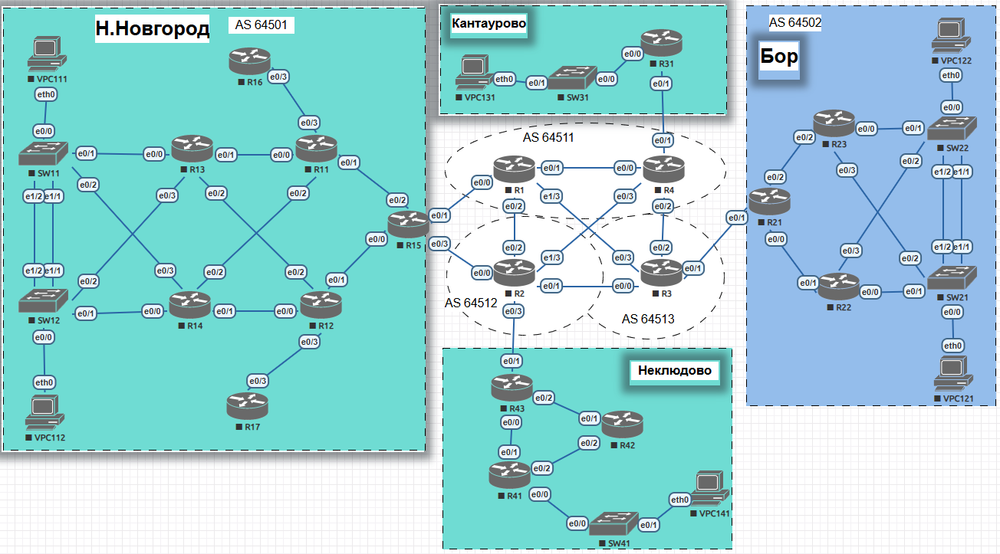

#  __Проектная работа__

### Организация сети до удаленных филиалов компании

###  Задание:

1. Запланировать и распределить адресное пространство
2. Реализовать статическую маршрутизацию на основе политик
3. Настроить VPN туннели (GRE, DMVPN)
4. Настроить протоколы маршрутизации (OSPF, EIGRP) внутри локальных сетей и поверх виртуальных каналов
5. Настроить протокол маршрутизации BGP внутри автономной системы и между ними
6. Настроить шифрование VPN соединений
7. Настроить инфраструктурные сервисы (DHCP, NTP, NAT)

### Cхема сети

###  1. Распределение адресного пространства
 - [Адресное пространство проекта](https://github.com/SavA559/otusntw/blob/main/final/md/addresses.md)

###  2. Статическая маршрутизация на основе политик
 - [PBR (Policy-based routing)](md/PBR.md)

###  3. VPN туннели
 - [GRE (Generic Routing Encapsulation)](md/vpn.md)
 - [DMVPN (Dynamic Multipoint VPN)](md/vpn.md#DMVPN)

###  4. Протоколы маршрутизации OSPF и EIGRP
 - [OSPF (Open Shortest Path First)](md/OSPF.md)
 - [EIGRP (Enhanced Interior Gateway Routing Protocol)](md/EIGRP.md)

###  5. Протокол маршрутизации BGP
 - [eBGP (Exterior Border Gateway Protocol)](md/BGP.md)
 - [iBGP (Interior Border Gateway Protocol)](md/BGP.md#пример-настройки-ibgp-и-ebgp-на-r1)

###  6. Шифрование VPN туннелей
  - [IPsec (Internet Protocol Security)](md/IPSec.md)

###  7. Инфраструктурные сервисы 
 - [DHCP (Dynamic Host Configuration Protocol); HSRP (Hot Standby Router Protocol)](md/DHCP.md)
 - [NTP (Network Time Protocol)](md/NTP.md)
 - [NAT (Network Address Translation); PAT (Port Address Translation)](md/NAT.md)

